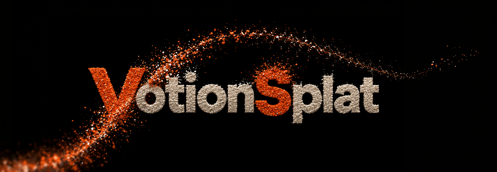

<p align="center"></p>

# VotionSplat 3.0

Windows app that turns a photo, a 360 panorama, or a sentence into a Gaussian splat for Unreal.

## Pipeline

1. **Home** downloads the models.
2. **Panorama** builds an 8K equirectangular image.
3. **Trajectories** plans walks and paints guides.
4. **Expand** fills the guides and can upscale them.
5. **Dataset** writes the training images, depth, and normals.
6. **Splat** trains the splat, optionally refines it, and exports `splat.ply`.


## Install (company machines)

See [docs/INSTALL.md](docs/INSTALL.md). The installer is on the company share, not in this repository.

## Developer setup

Python 3.12. The UI environment is `.venv`. Trajectories, Dataset, and Splat use `.venvs\hyworld`, built with `tools\hyworld\install.ps1`. HiRes uses `.venvs\seedvr2`. Difix uses `.venvs\difix`.

```
tools\launch.bat
```

## Unreal

[docs/UNREAL_EXPORT.md](docs/UNREAL_EXPORT.md)

## Build the installer

[docs/BUILD_INSTALLER.md](docs/BUILD_INSTALLER.md)

## More

- [User guide](docs/USER_GUIDE.md)
- [Models](docs/MODELS.md)
- [Changelog](docs/CHANGELOG.md)
- [Clickable mockup](https://titanothereyik.github.io/VotionSplat-mockup/)
- [Third-party notices](THIRD_PARTY_NOTICES.md)
- [License](LICENSE)
