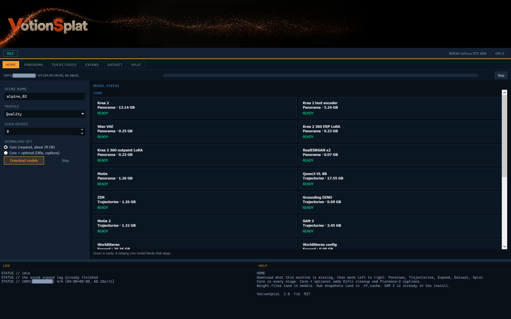
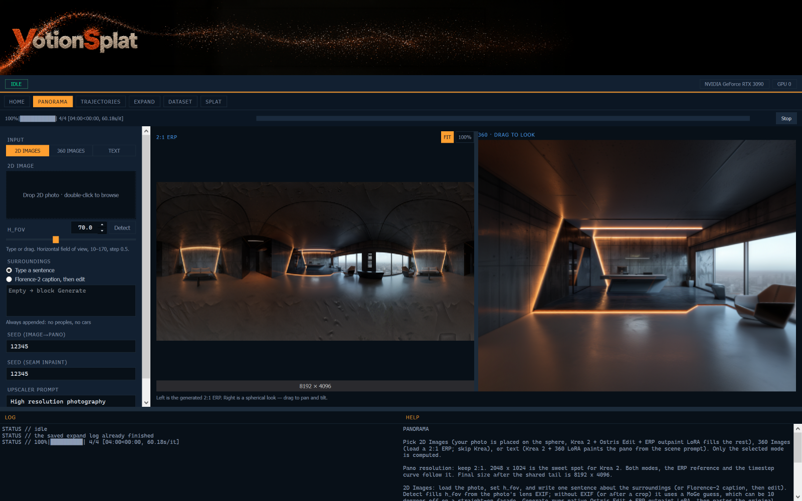
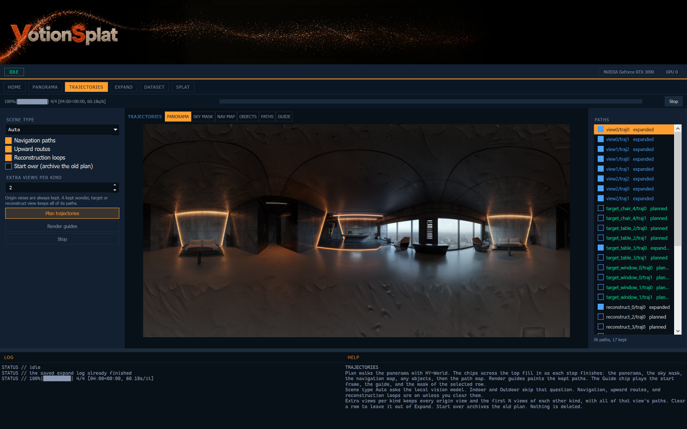
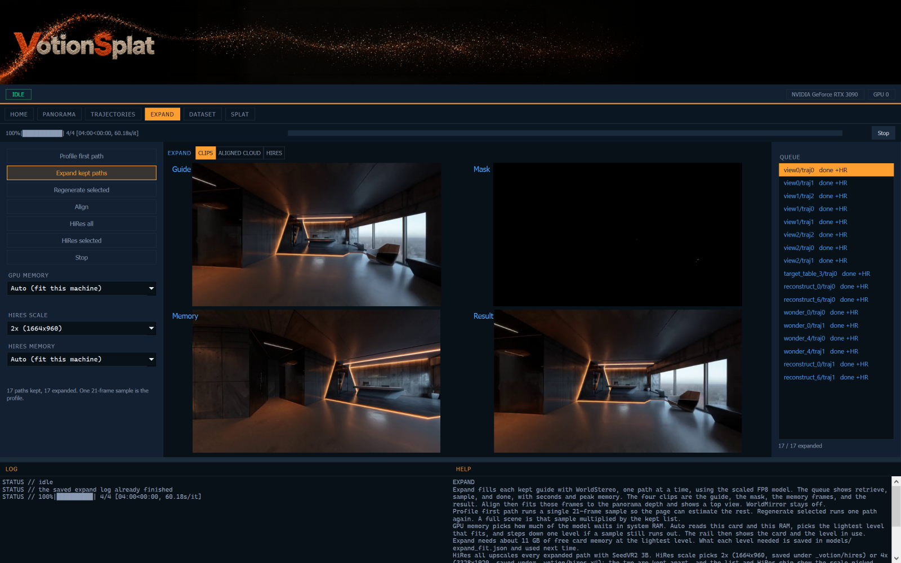
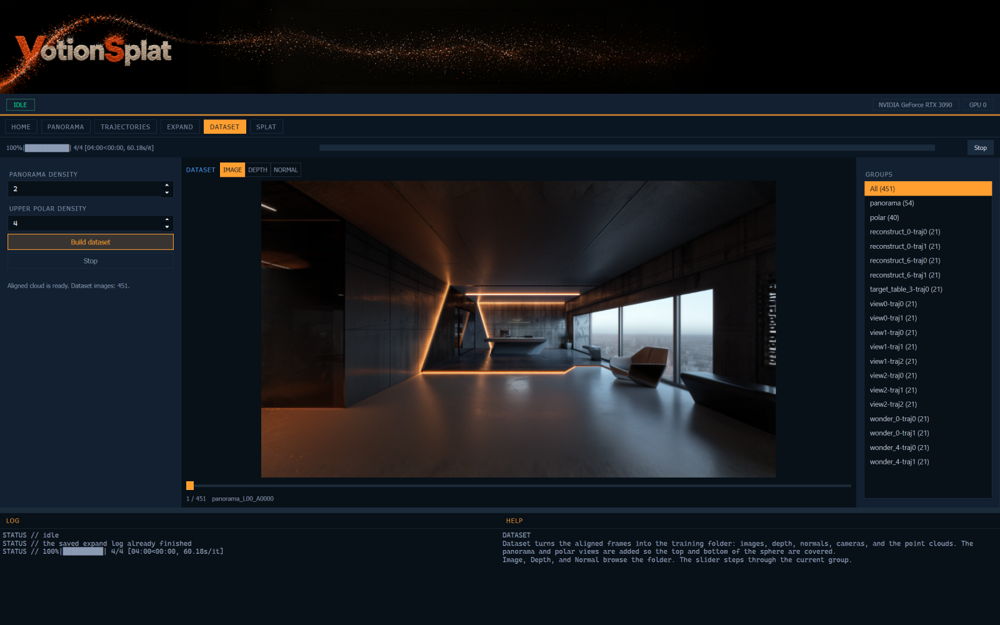
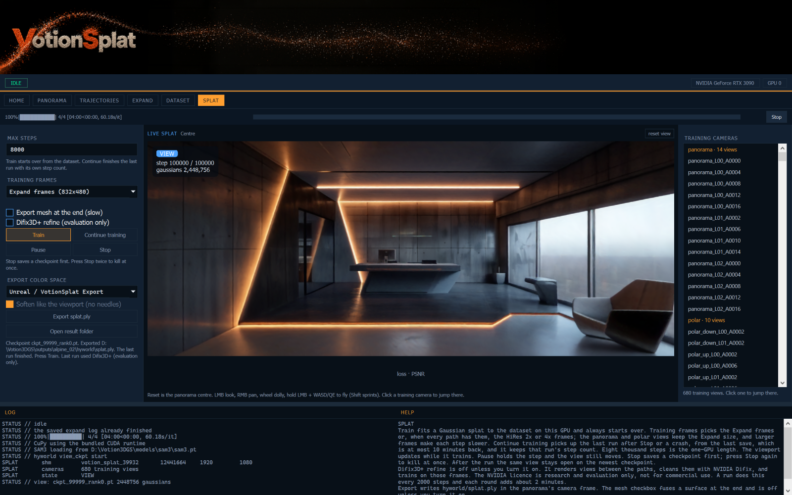

<p align="center"></p>

# VotionSplat 3.0

Windows app that turns a photo, a 360 panorama, or a sentence into a Gaussian splat for Unreal.

> **For the best result in Unreal, use [VotionSplat-UnrealPlugin](https://github.com/TitanothereYik/VotionSplat-UnrealPlugin).** It draws `splat.ply` with the same rasterizer rule, near plane, and spherical-harmonic degree the splat was trained with, so Unreal shows what the app viewport shows. See [Unreal](#unreal).

## Pipeline

1. **Home** downloads the models.
2. **Panorama** builds an 8K equirectangular image.
3. **Trajectories** plans walks and paints guides.
4. **Expand** fills the guides and can upscale them.
5. **Dataset** writes the training images, depth, and normals.
6. **Splat** trains the splat, optionally refines it, and exports `splat.ply`.

| Home | Panorama |
| --- | --- |
|  |  |
| **Trajectories** | **Expand** |
|  |  |
| **Dataset** | **Splat** |
|  |  |

Click through the same six pages in the [clickable mockup](https://titanothereyik.github.io/VotionSplat-mockup/).

## Install (company machines)

See [docs/INSTALL.md](docs/INSTALL.md). The installer is on the company share, not in this repository.

## Developer setup

Python 3.12. The UI environment is `.venv`. Trajectories, Dataset, and Splat use `.venvs\hyworld`, built with `tools\hyworld\install.ps1`. HiRes uses `.venvs\seedvr2`. Difix uses `.venvs\difix`.

```
tools\launch.bat
```

## Unreal

Use **[VotionSplat-UnrealPlugin](https://github.com/TitanothereYik/VotionSplat-UnrealPlugin)** (Unreal Engine 5.5, Win64) for the best result.

1. On the Splat page, export with **Unreal / VotionSplat Export** (the default).
2. Drag `outputs\<scene>\hyworld\splat.ply` into the Content Browser of a project that has the plugin. There is no import dialog.

The export writes Votion tags into the PLY header: the rasterizer, the near plane, and the spherical-harmonic degree. The plugin reads them and renders the splats with the same rule the trainer used. A generic 3DGS plugin loads the same file but draws it with its own rule and colour handling, so it will not match the app viewport.

More: [docs/UNREAL_EXPORT.md](docs/UNREAL_EXPORT.md). The installer also ships a prebuilt copy of the plugin in `unreal_plugin\`.

## Build the installer

[docs/BUILD_INSTALLER.md](docs/BUILD_INSTALLER.md)

## More

- [User guide](docs/USER_GUIDE.md)
- [Models](docs/MODELS.md)
- [Changelog](docs/CHANGELOG.md)
- [Clickable mockup](https://titanothereyik.github.io/VotionSplat-mockup/)
- [Third-party notices](THIRD_PARTY_NOTICES.md)
- [License](LICENSE)
